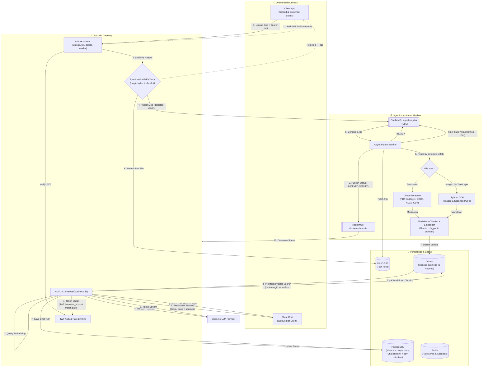

# ⚡ rag-vector-engine

> **Enterprise-grade Multi-Tenant RAG-as-a-Service Platform.**  
> Ingests unstructured business files (`.pdf`, `.docx`, `.xlsx`, `.csv`, images), converts them to layout-aware Markdown via **direct extraction** (or **LightOn OCR** for images and scanned PDFs), indexes into tenant-isolated vector partitions, and streams answers over authenticated WebSockets.

---

## 🎯 Architecture Overview

`rag-vector-engine` decouples compute-heavy, asynchronous document ingestion from low-latency, real-time query inference.



---

## ✨ Core Features

* **Multi-Tenant Isolation:** Complete logical tenant separation across relational storage, object storage prefixes (`minio://documents/{business_id}/...`), and vector indexes.
* **Byte-Level File Validation:** Uploaded files are untrusted. The client-supplied `Content-Type` header and file extension are ignored; the real MIME type is detected from the file's magic bytes and checked against an allowlist before anything is stored or queued (see [Upload Validation](#-upload-validation)).
* **Direct Extraction First, OCR Only When Needed:** Text-based files are parsed natively into Markdown (PDF text layer, DOCX headings/tables, XLSX/CSV sheets as Markdown tables), which is faster and more accurate than OCR and needs no GPU. Only images (`.png`, `.jpg`, `.tiff`) and scanned PDFs without a text layer are routed to **LightOn OCR**, which transcribes multi-column layouts, tables, and forms into structured Markdown.
* **Semantic & Markdown-Aware Chunking:** Chunks along `#`, `##`, and `###` headers while keeping tables intact. Metadata paths are prepended to every chunk vector.
* **Pluggable Embeddings:** Embeddings come from Gemini (`gemini-embedding-001`, 768 dimensions by default) behind a provider interface in `infra/embeddings/`. Callers depend only on the `Embedder` protocol (`embed_documents`, `embed_query`); `EMBEDDING_PROVIDER` picks the implementation from a registry, so switching providers means adding one module and one registry entry. The same provider, model, and dimensions must be used for indexing and for query embedding.
* **Reliable Async Processing:** Ingestion jobs flow through a RabbitMQ work queue with retries and a Dead-Letter Queue (DLQ). Document status changes (`PROCESSING`, `INDEXED`, `FAILED`) are published to a RabbitMQ `document.events` queue and consumed by the API to update PostgreSQL.
* **Status by Polling:** The dashboard polls `GET /v1/documents` to show live document status; there is no push channel for status updates.
* **Deletion & Re-indexing:** Tenants can delete a document (raw file, vectors, and metadata) or re-index it from the stored source file, e.g. after changing the chunker or embedding model.
* **Strict Prefiltered Vector Retrieval:** Queries apply hard pre-filtering on `business_id` before similarity calculation, eliminating cross-tenant data leaks. `business_id` is a payload index in Qdrant so the filter stays fast as tenants grow.
* **Token-Authenticated WebSocket Streaming:** Real-time conversational interface (`/v1/chat/ws/{business_id}`) serving low-latency streamed token frames and source citations.
* **Chat History with 7-Day Retention:** Each chat turn (question, answer, cited sources) is stored in PostgreSQL per tenant and session. Rows older than 7 days are purged by a scheduled cleanup job.

---

## 🗂️ Repository Layout

```text
rag-vector-engine/
├── api/                        # Synchronous FastAPI service
│   ├── main.py                 # App entrypoint & lifecycle
│   ├── consumers/
│   │   └── document_events.py  # Background consumer: applies document.events status events to PostgreSQL
│   ├── routes/
│   │   └── routes.py           # All routes: onboarding, documents, WebSocket chat (split later if needed)
│   ├── handlers/               # Business logic called by routes (routes stay thin)
│   │   ├── auth.py             # register / login
│   │   ├── chat.py             # Chat ticket + per-business WebSocket (/v1/chat/ws/{business_id})
│   │   └── documents.py        # Batch document upload (validate, store, record)
│   ├── rag.py                  # Retrieval (business-filtered, top-k, min score) + grounded prompt
│   ├── validators/
│   │   └── file_type.py        # Byte-level MIME sniffing & allowlist
│   └── middleware/
│       ├── auth.py             # JWT Bearer verification; claims → request.state.token_payload
│       ├── request_logger.py   # One log line per request (method, path, status, duration, business_id)
│       └── rate_limit.py       # Redis token bucket
│
├── common/                     # Shared building blocks (imported as `common.config`, `common.logger`, `common.auth`, `common.decorators`)
│   ├── config/
│   │   └── config.py           # Pydantic Settings
│   ├── logger/
│   │   └── logger.py           # Log format/level setup (LOG_LEVEL)
│   ├── auth/
│   │   ├── tokens.py           # JWT sign (encode) & verify (decode)
│   │   └── passwords.py        # Argon2id password hashing
│   └── decorators/
│       └── public.py           # @public: mark a route as reachable without a token
│
├── db/                         # Relational database
│   ├── postgres.py             # Async SQLAlchemy engine + per-request session (asyncpg)
│   ├── migrations/             # Alembic (env.py reads DATABASE_URL)
│   │   └── versions/           # Migration scripts
│   └── models/
│       ├── schema.py           # Relational schema (businesses, users, documents)
│       └── events.py           # RabbitMQ payloads (IngestionJob, DocumentStatusEvent)
│
├── infra/                      # External service clients
│   ├── embeddings/
│   │   ├── base.py             # Embedder protocol (provider interface) + errors
│   │   ├── gemini.py           # Gemini provider (google-genai): batched, retried, L2-normalized
│   │   └── factory.py          # Provider registry; EMBEDDING_PROVIDER selects the implementation
│   ├── llm/
│   │   ├── base.py             # ChatModel protocol (streaming) + errors
│   │   ├── gemini.py           # Gemini chat provider (streamed generate_content)
│   │   └── factory.py          # Provider registry; LLM_PROVIDER selects the implementation
│   ├── queue/
│   │   ├── queue.py            # RabbitMQ connect / channel / standard queue declaration
│   │   └── publisher.py        # Ingestion job publisher used by the upload route
│   ├── redis/
│   │   └── redis.py            # Redis client
│   └── storage/
│       ├── blob.py             # BlobStorage interface + S3-API adapter (MinIO or AWS S3)
│       └── vector_db.py        # VectorStore protocol + Qdrant store (mandatory business_id pre-filter)
│
├── workers/                    # Ingestion pipeline worker
│   ├── consumer.py             # Consumes INGESTION_QUEUE, reports status to DOCUMENT_EVENTS_QUEUE (INDEXED for now; DLQ later)
│   ├── extractor.py            # Routing by detected MIME + direct extraction to Markdown
│   ├── ocr.py                  # LightOn OCR for images & scanned PDFs
│   ├── chunker.py              # Simple paragraph-packing chunker (Markdown-aware splitting later)
│   ├── embedder.py             # Pipeline step: embeds chunks via infra.embeddings, upserts into the vector store
│   └── publisher.py            # RabbitMQ document status publisher
│
├── tests/                      # pytest suite
│   ├── conftest.py             # Test env (JWT_SECRET)
│   ├── api/
│   │   ├── conftest.py         # Postgres test DB + in-memory blob storage fixtures
│   │   ├── test_auth.py        # JWT middleware tests
│   │   ├── test_documents.py   # Document upload tests
│   │   ├── test_file_type.py   # Magic-byte upload validation tests
│   │   ├── test_main.py        # FastAPI app smoke test
│   │   └── test_onboarding.py  # Register / login (integration tests run against Postgres)
│   ├── common/
│   │   ├── test_passwords.py   # Password hashing tests
│   │   └── test_tokens.py      # JWT encode/decode tests
│   ├── infra/
│   │   ├── queue/
│   │   │   └── test_publisher.py # Job publisher tests (integration tests run against RabbitMQ)
│   │   └── storage/
│   │       └── test_blob.py    # Blob adapter tests (integration tests run against MinIO)
│   └── workers/
│       ├── sample_documents.py # Builds real PDF/DOCX/XLSX test files
│       ├── test_extractor.py   # Extraction to Markdown per file type
│       ├── test_chunker.py     # Chunk packing, overlap, and long-paragraph splitting
│       └── test_consumer.py    # Worker integration tests (run against RabbitMQ)
│
├── docker-compose.yml          # Local infra (MinIO + bucket init, Postgres, RabbitMQ, Qdrant)
├── alembic.ini                 # Alembic configuration
├── .env.example                # Sample environment configurations
├── pyproject.toml              # pytest configuration
├── requirements.txt            # Python dependencies
└── requirements-dev.txt        # Dev/test dependencies (pytest)
```

---

## 🚀 Quickstart

### 1. Prerequisites
* Python 3.11+ (tested on 3.15)
* Docker & Docker Compose
* NVIDIA GPU (optional; only needed to run LightOn OCR locally on images and scanned PDFs)

### 2. Infrastructure Setup
Clone the repository and boot the local service stack:

```bash
git clone https://github.com/<your-username>/rag-vector-engine.git
cd rag-vector-engine

# Copy environment variables
cp .env.example .env

# Start local infrastructure (MinIO, Postgres, RabbitMQ, and Qdrant; Redis is
# added to docker-compose.yml when it is built)
docker compose up -d
```

The `minio-init` container creates the `documents` bucket and exits. Qdrant listens on http://localhost:6333 (`QDRANT_PORT`; dashboard at `/dashboard`); the worker creates the `document_chunks` collection on startup. The MinIO console is at http://localhost:9001 (`minioadmin` / `minioadmin`). The RabbitMQ management UI is at http://localhost:15672 (`rve` / `rve`). Postgres listens on host port **5433** (`POSTGRES_PORT`), so it doesn't clash with a natively installed Postgres on 5432.

### 3. Install Dependencies
```bash
python -m venv .venv
source .venv/bin/activate
pip install -r requirements.txt
```

For development and tests, install `requirements-dev.txt` instead and run the suite (MinIO, Postgres, RabbitMQ, and Qdrant integration tests are skipped automatically if the service isn't running, and the live Gemini test if `GEMINI_API_KEY` is unset). Postgres tests create and migrate a separate `rve_test` database (`TEST_DATABASE_URL`):
```bash
pip install -r requirements-dev.txt
pytest -v
```

### 4. Run Migrations & Start Services
Apply database migrations:
```bash
alembic upgrade head
```

After changing `db/models/schema.py`, generate a new migration with `alembic revision --autogenerate -m "<description>"` and review it before committing.

Terminal 1 — API Gateway:
```bash
uvicorn api.main:app --host 0.0.0.0 --port 8000 --reload
```

Terminal 2 — Ingestion Worker:
```bash
python -m workers.consumer
```

The frontend lives in a separate repository and talks to this API over HTTP and WebSockets.

---

## 🔌 API & Integration Guide

### 1. Onboard a Business
Registering creates the business and its first user (role `owner`) in one transaction and returns a signed JWT access token. Send it as `Authorization: Bearer <token>` on every other request.

```bash
curl -X POST http://localhost:8000/v1/auth/register \
  -H "Content-Type: application/json" \
  -d '{"business_name": "Acme Corp", "email": "admin@acme.com", "password": "s3cret-passw0rd"}'
```

**Response (`201 Created`):**
```json
{
  "business_id": "0192f6a4-3b1e-7c2d-9a4f-5e8b1c2d3e4f",
  "user_id": "0192f6a4-3b1f-7a10-8b2c-6d7e8f901a2b",
  "access_token": "eyJhbGciOiJIUzI1NiIsInR5cCI6IkpXVCJ9...",
  "token_type": "bearer",
  "expires_in": 3600
}
```

* Emails are stored lowercased and are unique across the platform; registering an existing email returns `409 Conflict`.
* Passwords must be 8–128 characters and are stored as Argon2id hashes (`common/auth/passwords.py`).
* The token's `sub` claim is the `user_id`; its `business_id` claim scopes every later request.

When the token expires, log in again for a new one (same response shape, `200 OK`). A wrong password and an unknown email both return the same `401`:

```bash
curl -X POST http://localhost:8000/v1/auth/login \
  -H "Content-Type: application/json" \
  -d '{"email": "admin@acme.com", "password": "s3cret-passw0rd"}'
```

The examples below assume the token is stored in a shell variable:

```bash
export ACCESS_TOKEN="eyJhbGciOiJIUzI1NiIsInR5cCI6IkpXVCJ9..."
```

---

### 2. Ingest Business Documents
Upload up to **50 files per request** (`MAX_UPLOAD_FILES`) as repeated multipart fields named `files`. Accepted types for now: **PDF, DOCX, XLSX, CSV, and TXT**; images are rejected on this route until OCR lands. Each file is stored in object storage under the caller's `business_id` (taken from the token) and recorded in PostgreSQL with status `QUEUED`. Once the whole batch is stored, one ingestion job per document is published to the `INGESTION_QUEUE` (`ingestion.jobs`) as a persistent JSON message, with publisher confirms; the worker uses its `storage_key` to fetch the file from object storage:

```json
{
  "schema_version": 1,
  "doc_id": "0192f6a5-1c2d-7e3f-a4b5-c6d7e8f90a1b",
  "business_id": "0192f6a4-3b1e-7c2d-9a4f-5e8b1c2d3e4f",
  "storage_key": "0192f6a4-3b1e-7c2d-9a4f-5e8b1c2d3e4f/0192f6a5-1c2d-7e3f-a4b5-c6d7e8f90a1b/source.pdf",
  "detected_mime": "application/pdf",
  "filename": "quarterly_report.pdf",
  "size_bytes": 482113,
  "uploaded_at": "2026-10-29T11:40:51.120000Z"
}
```

The message's `message_id` is the `doc_id` and its `type` is `ingestion.job`. Retries and a dead-letter queue are not set up yet.

The worker (`python -m workers.consumer`) reports each job's outcome as a status event on `DOCUMENT_EVENTS_QUEUE` (`document.events`), and acks the job only after RabbitMQ has confirmed that event. The API consumes the queue in the background (disable with `CONSUME_DOCUMENT_EVENTS=false`) and updates the document row (`status`, and `status_detail` from the event's `detail`), matching both `doc_id` and `business_id`; a late `PROCESSING` event never overwrites a final status.

For each job the worker reports `PROCESSING`, downloads the source file, extracts it to Markdown (`workers/extractor.py`, routed by `detected_mime`) and stores the result next to the source as `{business_id}/{doc_id}/extracted.md`:

| Type | Markdown produced |
|------|-------------------|
| PDF | Text layer via `pypdf`, one `## Page N` section per page with text |
| DOCX | `python-docx`: Title/Heading N → `#` headings, bullet/numbered lists, tables → Markdown tables |
| XLSX | `openpyxl` (cached values): one `## Sheet: <name>` table per non-empty sheet |
| CSV | One Markdown table (delimiter sniffed) |
| TXT | The text as is |

Next, `workers/chunker.py` splits the Markdown with a simple paragraph packer: blank-line separated paragraphs are packed into chunks of at most `CHUNK_SIZE` characters (default 1000), each chunk repeating up to `CHUNK_OVERLAP` characters (default 150) from the end of the previous one, starting on a word boundary. Only paragraphs longer than `CHUNK_SIZE` are split (at whitespace). Headers and tables get no special treatment yet. The chunks are stored as `{business_id}/{doc_id}/chunks.jsonl`, one JSON object per line, where `text` is `extracted.md[start:end]`:

```json
{"index": 0, "text": "## Page 1\n\nQuarterly revenue grew ...", "start": 0, "end": 918}
```

The chunks are then embedded (`infra/embeddings`, Gemini by default) and upserted into Qdrant under the document's `business_id` (`workers/embedder.py`), and the worker reports `INDEXED`. Documents that can't be processed are reported as `FAILED` with a `detail`: PDFs without a text layer (scanned; OCR is not available yet), password-protected or damaged files, files with no text, a missing source file, or input the embedding provider rejects. Storage, RabbitMQ and Qdrant errors, and transient embedding errors (rate limits, provider outages), requeue the job instead:

```json
{
  "schema_version": 1,
  "doc_id": "0192f6a5-1c2d-7e3f-a4b5-c6d7e8f90a1b",
  "business_id": "0192f6a4-3b1e-7c2d-9a4f-5e8b1c2d3e4f",
  "status": "INDEXED",
  "occurred_at": "2026-10-29T11:42:07.300000Z",
  "detail": null
}
```

```bash
curl -X POST http://localhost:8000/v1/documents/upload \
  -H "Authorization: Bearer $ACCESS_TOKEN" \
  -F "files=@quarterly_report.pdf" \
  -F "files=@pricing.xlsx" \
  -F "files=@notes.txt"
```

**Response (`201 Created`):**
```json
{
  "documents": [
    {
      "doc_id": "0192f6a5-1c2d-7e3f-a4b5-c6d7e8f90a1b",
      "filename": "quarterly_report.pdf",
      "status": "QUEUED",
      "detected_mime": "application/pdf",
      "size_bytes": 482113,
      "storage_key": "0192f6a4-3b1e-7c2d-9a4f-5e8b1c2d3e4f/0192f6a5-1c2d-7e3f-a4b5-c6d7e8f90a1b/source.pdf"
    }
  ]
}
```

Uploads are **all or nothing**: if any file's bytes don't match an allowed type (for example, an `.exe` renamed to `report.pdf`) or a file is too large, nothing in the batch is stored and every rejected file is listed. The status is `413` if every rejection is for size, otherwise `415`:

**Response (`415 Unsupported Media Type`):**
```json
{
  "detail": "1 of 2 files were rejected; nothing was stored",
  "errors": [
    {
      "index": 1,
      "filename": "report.pdf",
      "detail": "Unsupported or mismatched file type",
      "detected_mime": "application/x-msdownload"
    }
  ]
}
```

Other limits, checked before the request body is read:

| Condition | Status |
|-----------|--------|
| Missing or invalid token | `401` |
| No `Content-Length` header | `411` |
| Request body larger than `MAX_BATCH_BYTES` (default 200 MiB) | `413` |
| More than `MAX_UPLOAD_FILES` files | `400` |
| No `files` parts, or a `files` part that isn't a file | `422` |

If storage fails partway through, objects already written for the batch are deleted and the response is `502`. If RabbitMQ does not confirm every job (for example, it is down), the batch's rows and objects are deleted and the response is `503`, so a stored document always has a queued job.

---

### 3. Track Document Status (Polling)
There is no push channel for ingestion status; clients poll the document list (the dashboard does this every few seconds while any document is `QUEUED` or `PROCESSING`).

```bash
curl http://localhost:8000/v1/documents \
  -H "Authorization: Bearer $ACCESS_TOKEN"
```

**Response:**
```json
{
  "documents": [
    {
      "doc_id": "0192f6a5-1c2d-7e3f-a4b5-c6d7e8f90a1b",
      "filename": "quarterly_report.pdf",
      "status": "INDEXED",
      "status_detail": null,
      "detected_mime": "application/pdf",
      "size_bytes": 482113,
      "created_at": "2026-10-29T11:40:51Z",
      "updated_at": "2026-10-29T11:42:07Z"
    }
  ]
}
```

Documents are scoped to the token's `business_id` and returned newest first. `status_detail` is the failure reason when `status` is `FAILED` (for example `"The PDF has no text layer (scanned?); OCR is not available yet"`), otherwise `null`.

A single document can be fetched with `GET /v1/documents/{doc_id}` (same fields). Its extracted Markdown is served by `GET /v1/documents/{doc_id}/markdown` as `text/markdown`, once the document is `INDEXED` (`409` before that):

```bash
curl http://localhost:8000/v1/documents/0192f6a5-1c2d-7e3f-a4b5-c6d7e8f90a1b/markdown \
  -H "Authorization: Bearer $ACCESS_TOKEN"
```

Both return `404` for a document that doesn't exist or belongs to another business.

---

### 4. Delete a Document
Removes the document's vectors from Qdrant (filtered by `business_id` **and** `doc_id`), its objects under `{business_id}/{doc_id}/` in MinIO, and its PostgreSQL record.

```bash
curl -X DELETE http://localhost:8000/v1/documents/0192f6a5-1c2d-7e3f-a4b5-c6d7e8f90a1b \
  -H "Authorization: Bearer $ACCESS_TOKEN"
```

**Response:** `204 No Content`

---

### 5. Re-index a Document
Deletes the document's existing vectors and re-queues an ingestion job from the stored source file. The status goes back to `QUEUED`.

```bash
curl -X POST http://localhost:8000/v1/documents/0192f6a5-1c2d-7e3f-a4b5-c6d7e8f90a1b/reindex \
  -H "Authorization: Bearer $ACCESS_TOKEN"
```

**Response:**
```json
{
  "doc_id": "0192f6a5-1c2d-7e3f-a4b5-c6d7e8f90a1b",
  "status": "QUEUED"
}
```

Deleting or re-indexing a document that is currently `QUEUED` or `PROCESSING` returns `409 Conflict`, so an in-flight job can't write vectors for a document that was just removed.

---

### 6. Query via Authenticated WebSocket
Each business chats over its own socket, `/v1/chat/ws/{business_id}`. Browsers can't set headers on WebSocket connections, so the JWT is passed as the `token` query parameter and verified by the WebSocket route itself. The `{business_id}` in the path selects whose documents are searched, but it is only trusted once it matches the token's `business_id` claim; otherwise the server closes the connection.

Browser clients shouldn't hold the access token, so they first exchange it for a short-lived, chat-only **ticket** (`CHAT_TICKET_EXPIRES_IN`, default 60 s). A ticket only opens the socket (it is rejected as a Bearer token on every HTTP route), and the socket stays usable until the access token it was issued from would have expired:

```bash
curl -X POST http://localhost:8000/v1/chat/ticket -H "Authorization: Bearer $ACCESS_TOKEN"
# {"ticket": "eyJ...", "business_id": "0192f6a4-...", "expires_in": 60, "ws_path": "/v1/chat/ws/0192f6a4-...", "token_type": "chat_ws"}
```

```javascript
const businessId = "0192f6a4-3b1e-7c2d-9a4f-5e8b1c2d3e4f";
const ticket = "eyJhbGciOiJIUzI1NiIsInR5cCI6IkpXVCJ9..."; // or an access token

const socket = new WebSocket(`ws://localhost:8000/v1/chat/ws/${businessId}?token=${ticket}`);

socket.onopen = () => {
  socket.send(JSON.stringify({
    query: "What were our total operating revenues for Q3?",
    session_id: "client_session_442" // optional; echoed in every frame
  }));
};

socket.onmessage = (event) => {
  const data = JSON.parse(event.data);
  if (data.type === "delta") {
    process.stdout.write(data.content); // streamed answer text
  } else if (data.type === "done") {
    console.log("\nSources:", data.sources);
  } else if (data.type === "error") {
    console.error(data.detail);
  }
};
```

For every question the server embeds the query (`embed_query`), searches Qdrant pre-filtered by the authenticated `business_id`, and keeps at most `RETRIEVAL_TOP_K` chunks (default 5) whose cosine similarity is at least `RETRIEVAL_MIN_SCORE` (default 0.65). Those excerpts go to the chat model (`infra/llm`, Gemini `gemini-3.5-flash-lite` by default via `LLM_MODEL`), which is instructed to answer only from them, cite them as `[1]`, `[2]`, and treat their content as data rather than instructions. If no chunk passes the threshold, the answer is "I couldn't find anything in your documents that answers this question." and the model isn't called. The `done` frame lists the sources:

```json
{"type": "done", "session_id": "client_session_442", "sources": [
  {"number": 1, "doc_id": "0192f6a5-...", "filename": "strategy.pdf", "chunk_index": 0, "score": 0.7291, "excerpt": "## Page 1\n\nStrategy 2027: ..."}
]}
```

| Situation | Result |
|-----------|--------|
| Missing, invalid, or expired token | Close code `4401` |
| Token belongs to another business | Close code `4403` |
| Login session (access token) has expired | `error` frame, then close code `4401` |
| Malformed message (not JSON, empty or > `CHAT_MAX_QUERY_CHARS` query) | `error` frame; the socket stays open |
| Embedding or answer generation fails | `error` frame; the socket stays open |

Token values in URLs are redacted from the server logs.

---

## 🪣 Object Storage (MinIO now, AWS S3 later)

Raw files are stored through a single adapter, `infra/storage/blob.py`. Callers depend only on the `BlobStorage` interface (`put_object`, `get_object`, `head_object`, `exists`, `delete_object`, `delete_prefix`, `ensure_bucket`), obtained via `get_blob_storage()`.

The implementation, `S3BlobStorage`, talks the S3 API (`aioboto3`). MinIO is S3-compatible, so **switching between local MinIO and AWS S3 is configuration only, with no code changes**:

| Variable | Local MinIO | AWS S3 |
|----------|-------------|--------|
| `S3_ENDPOINT_URL` | `http://localhost:9000` | empty |
| `S3_FORCE_PATH_STYLE` | `true` | `false` |
| `S3_ACCESS_KEY_ID` / `S3_SECRET_ACCESS_KEY` | MinIO root credentials | IAM keys, or empty to use the default AWS credential chain (IAM role, profile) |
| `S3_REGION` | `us-east-1` | your bucket's region |
| `S3_BUCKET` | `documents` | your bucket name |

Object keys are always built with `object_key(business_id, doc_id, ext)` → `{business_id}/{doc_id}/source.{ext}`, which rejects any ID or extension that could escape the tenant prefix.

> **MinIO image:** the official `minio/minio` images are no longer published on Docker Hub, so `docker-compose.yml` uses the community-maintained build [`pgsty/minio`](https://hub.docker.com/r/pgsty/minio), pinned to a specific release.

---

## 🔍 Upload Validation

Uploaded documents are treated as untrusted input. The client-supplied `Content-Type` header and file extension are **never** trusted. Instead, `api/validators/file_type.py` (`detect_file_type`) inspects the raw bytes of the file and only accepts types on the allowlist. Magic-number sniffing uses the pure-Python [`filetype`](https://pypi.org/project/filetype/) package (no native `libmagic` needed), with our own checks on top for ZIP containers and CSV, which magic bytes alone can't validate:

| Type | Detected MIME | Byte-level check |
|------|---------------|------------------|
| PDF | `application/pdf` | Starts with `%PDF-` (`25 50 44 46 2D`) |
| PNG | `image/png` | Starts with `89 50 4E 47 0D 0A 1A 0A` |
| JPEG | `image/jpeg` | Starts with `FF D8 FF` |
| TIFF | `image/tiff` | Starts with `49 49 2A 00` or `4D 4D 00 2A` |
| DOCX | `application/vnd.openxmlformats-officedocument.wordprocessingml.document` | ZIP header `50 4B 03 04` **and** archive contains `word/document.xml` |
| XLSX | `application/vnd.openxmlformats-officedocument.spreadsheetml.sheet` | ZIP header `50 4B 03 04` **and** archive contains `xl/workbook.xml` |
| CSV | `text/csv` | No magic bytes: must decode as UTF-8, contain no NUL bytes, and parse as delimited rows (`,` `;` tab or `\|`) with a consistent column count of at least 2 |
| TXT | `text/plain` | No magic bytes: must decode as UTF-8 (BOM allowed) with no control characters other than tab, newlines, and form feed. Delimited text named `.txt` is treated as TXT, not CSV |

The upload route narrows this allowlist with `detect_file_type(..., allowed=...)`; `POST /v1/documents/upload` currently accepts PDF, DOCX, XLSX, CSV, and TXT.

Validation rules:

1. **Detected type wins.** The MIME type detected from the bytes is the only one used downstream. It is stored in PostgreSQL and passed in the RabbitMQ job payload, and the worker routes extraction/OCR by it.
2. **Reject on mismatch.** Anything not on the allowlist, or whose bytes contradict the declared type, is rejected with `415` before it reaches MinIO or the queue.
3. **Inspect ZIP containers.** DOCX and XLSX are ZIP archives, so the archive's entries are checked to tell them apart from arbitrary ZIPs. Macro-enabled documents (containing `vbaProject.bin`) are rejected, and total uncompressed size is capped to block zip bombs.
4. **Size limit.** Uploads above `MAX_UPLOAD_BYTES` (default 25 MiB) are rejected before sniffing; DOCX/XLSX archives whose total uncompressed size exceeds `MAX_UNCOMPRESSED_BYTES` (default 200 MiB) are rejected as zip bombs.
5. **Safe storage keys.** The original filename is kept only as metadata; object keys are built from server-generated IDs so user input can't cause path traversal.

---

## 🛡️ Tenant Isolation & Security Guarantees

1. **Object Storage:** Documents are stored using strict tenant prefixes: `s3://bucket/{business_id}/{doc_id}/source.{ext}`, where `ext` comes from the detected MIME type, not the uploaded filename.
2. **Vector Space:** Chunks are tagged with a non-bypassable `business_id` payload field. All vector retrieval queries execute an indexed exact-match pre-filter:
   ```python
   models.Filter(
       must=[
           models.FieldCondition(
               key="business_id",
               match=models.MatchValue(value=authenticated_business_id)
           )
       ]
   )
   ```
   This is implemented in `infra/storage/vector_db.py` (`QdrantVectorStore`), where `business_id` is a required keyword argument of every read and delete, so an unscoped query can't be written. All tenants share one collection (`QDRANT_COLLECTION`, cosine distance, `EMBEDDING_DIMENSIONS`): `business_id` is a keyword index with `is_tenant=true` (tenant-aware storage), the global HNSW graph is disabled (`m=0`) in favour of per-tenant graphs (`payload_m=16`), and `doc_id` / `chunk_index` are indexed for deletion and re-indexing. Point ids are `uuid5(doc_id, chunk_index)`, so re-indexing a document overwrites its points in place and then drops any stale higher-numbered chunks.
3. **JWT Authentication:** Tokens are signed and verified in one place, `common/auth/tokens.py` (`JWTCodec.encode` / `JWTCodec.decode`, HS256 with `JWT_SECRET` of at least 32 characters, lifetime `JWT_EXPIRES_IN` seconds). `api/middleware/auth.py` reads `Authorization: Bearer <token>`, verifies it with the codec, and requires the `sub`, `business_id`, and `exp` claims. The decoded claims are attached to the request as `request.state.token_payload` (routes read them via the `get_token_payload` dependency). **Every route is protected by default** via the app-wide `require_auth` dependency; missing, malformed, expired, or wrongly signed tokens get `401`. To make a route public, decorate its endpoint/handler with `@public` (from `common.decorators`):
   ```python
   @public
   async def login(): ...
   ```
   Currently public: `GET /health`, `POST /v1/auth/register`, `POST /v1/auth/login`, plus FastAPI's docs (`/docs`, `/redoc`, `/openapi.json`). The chat WebSocket is `@public` at the HTTP layer and authenticates its `token` query parameter itself. Tokens carrying a `token_use` claim (chat tickets) are rejected by every HTTP route.
4. **Business Comes from the Token:** `business_id` is always taken from the verified token, never from request bodies. On the WebSocket route, a `{business_id}` path value that doesn't match the token's `business_id` claim is rejected.
5. **Untrusted Uploads:** File types are validated from raw bytes, never from headers or extensions; see [Upload Validation](#-upload-validation).
6. **Chat History Retention:** Stored chat turns are scoped to the tenant and deleted after 7 days.

---

## 📜 License
Apache-2.0 © 2026 rag-vector-engine contributors.